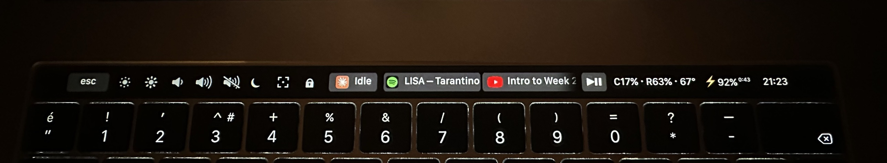
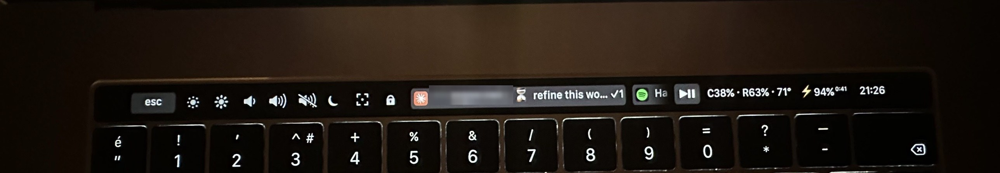
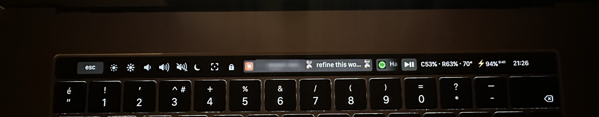
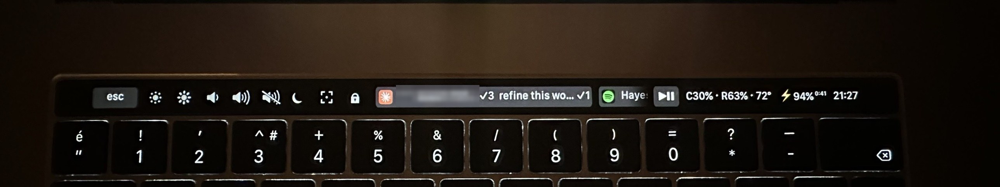

# mtmr-touchbar

My Touch Bar setup for a 2017 MacBook Pro 15" (A1707) running macOS Ventura. It uses [MTMR](https://github.com/Toxblh/MTMR) to replace the stock Touch Bar with the things I actually press, plus a couple of status widgets.



## What's on it

From left to right:

- Esc, brightness down/up, volume down/up, mute
- Night mode toggle (moon icon): turns Night Shift on and off
- Screenshot button: grabs the whole screen and puts it on the clipboard
- Lock button: locks the screen
- Claude Code status: one entry per running session, with the session name and a state
- Now playing: Spotify or YouTube (Chrome), title shown, tap to play/pause, double tap for the next track
- System play/pause key
- CPU, RAM and temperature
- Battery and clock

### Claude Code status

Each local Claude Code session gets its own entry named after the first words of its first prompt.

| shown | meaning |
| --- | --- |
| `name ⏳` | working |
| `name ❗` | waiting for you (permission prompt) |
| `name ✓3` | finished, 3 answers so far |
| `Idle` | no sessions |

Tap the widget to clear everything. The states come from Claude Code hooks, so this only works for local Claude Code sessions, not for the chat tab or cloud sessions.

One session finished, the other still working:



Both sessions working:



Both finished (the number is how many answers each one has given):



### Now playing

Spotify is read over AppleScript. For YouTube it looks for a playing watch tab in Chrome. If both are playing, both show up, and each one has its own tap and double tap. For the Chrome part you need View > Developer > Allow JavaScript from Apple Events turned on.

### CPU / RAM / temperature

Shown as `C31% · R63% · 72°`. The numbers are sampled in the background and the widget just reads the last value, because sampling takes a second or two and MTMR shows `error` if a script is slow. Temperature needs [osx-cpu-temp](https://github.com/lavoiesl/osx-cpu-temp); the installer tries to build it and skips it if that fails.

## Install

1. Install MTMR from its releases page and open it once. It needs Accessibility permission. Since it isn't notarized you may have to allow it in System Settings > Privacy & Security.
2. Install the Xcode command line tools if you don't have them (`xcode-select --install`).
3. Run:

```
git clone https://github.com/et4nn/mtmr-touchbar.git
cd mtmr-touchbar
./install.sh
```

The installer copies the scripts to `~/.config/mtmr`, builds the night mode helper, draws the icons, backs up your current MTMR `items.json`, writes the new one and merges the hooks into `~/.claude/settings.json` (a `.bak` copy is made first).

The first time you use some buttons, macOS will ask for permissions (Automation for Spotify and Chrome, Screen Recording for the screenshot button, Accessibility for the lock button).

## Notes

- Night mode uses the private `CoreBrightness` framework (`CBBlueLightClient`). It works on Ventura 13.7 here, it may break on other versions.
- The lock button sends Ctrl+Cmd+Q through System Events.
- The icons are drawn by `tools/make_icons.py` as plain gray shapes. No logos are included. If you want real ones, put PNGs with the same file names in `~/.config/mtmr/` before running the installer; existing files are not overwritten.
- MTMR can't change text color or font size, so the status widgets rely on short text and symbols.
- Only tested on one machine.

## Credits

MTMR by Toxblh does all the Touch Bar work. The Claude status idea came from looking at TouchMyBar/claudebar and claude-status-touch-bar.
